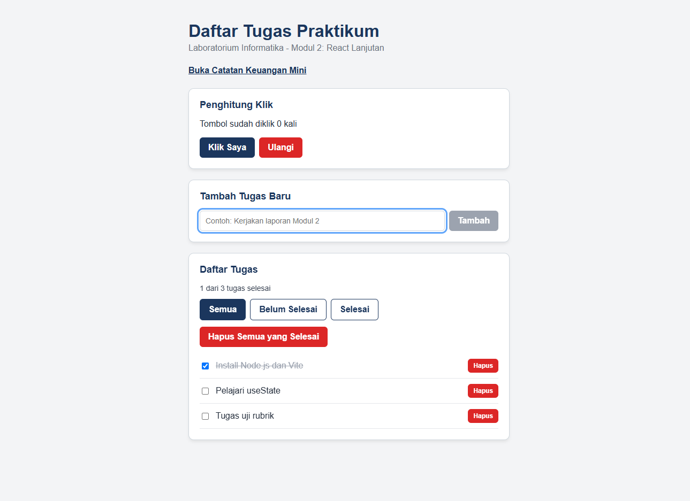
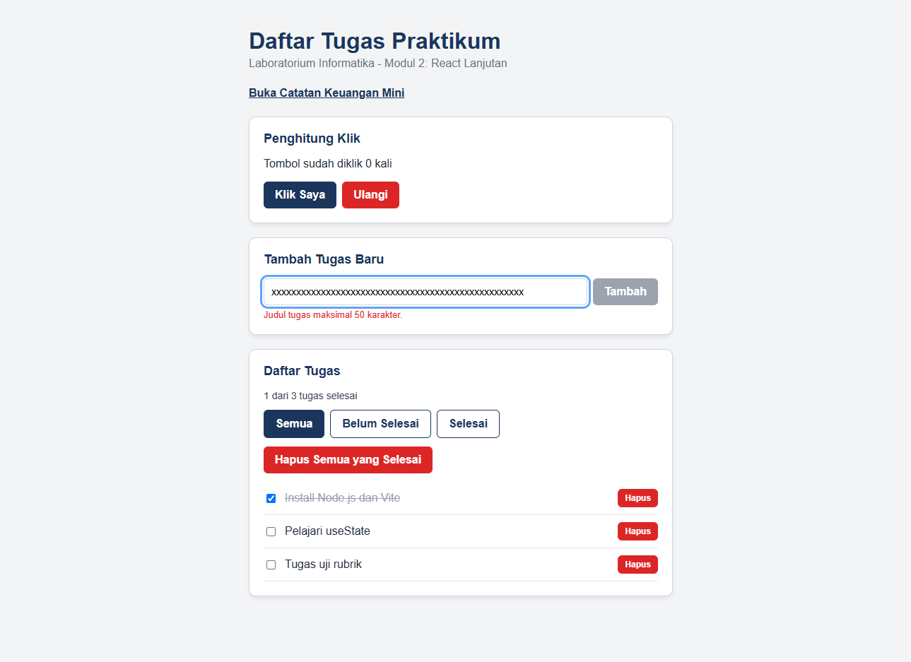
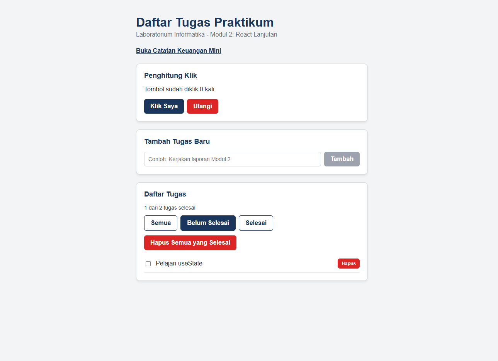
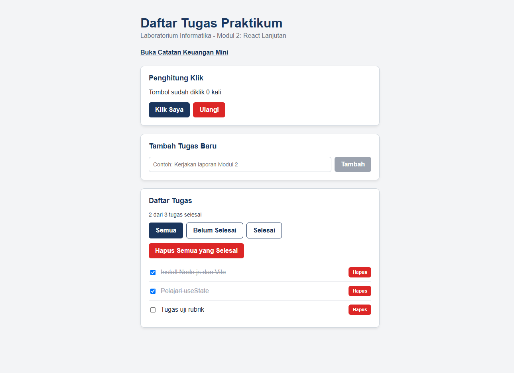
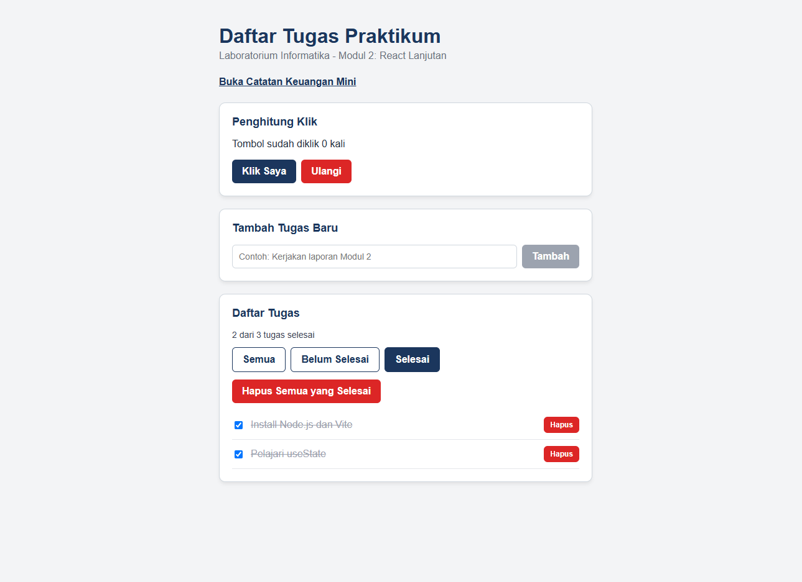
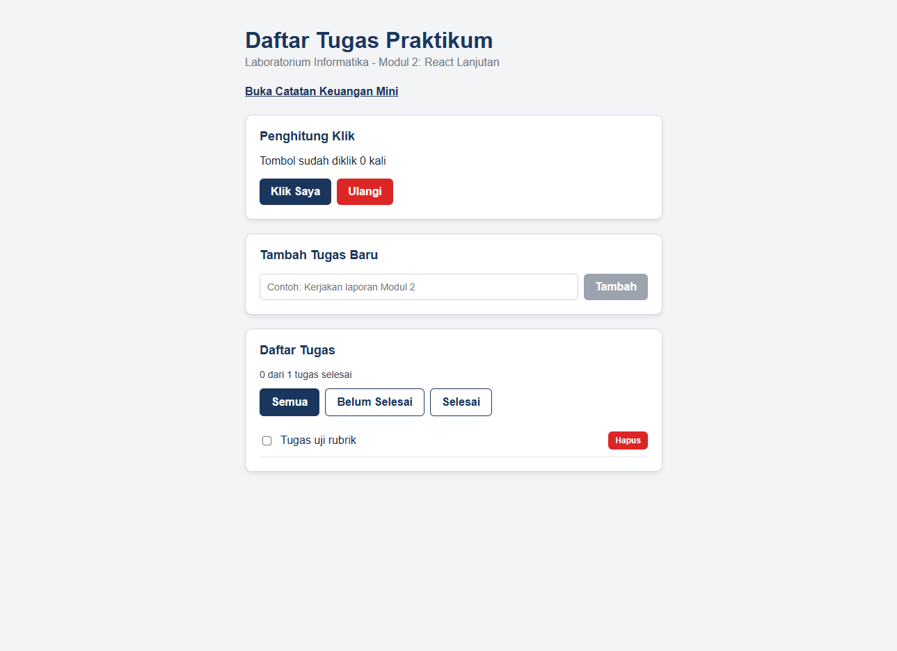
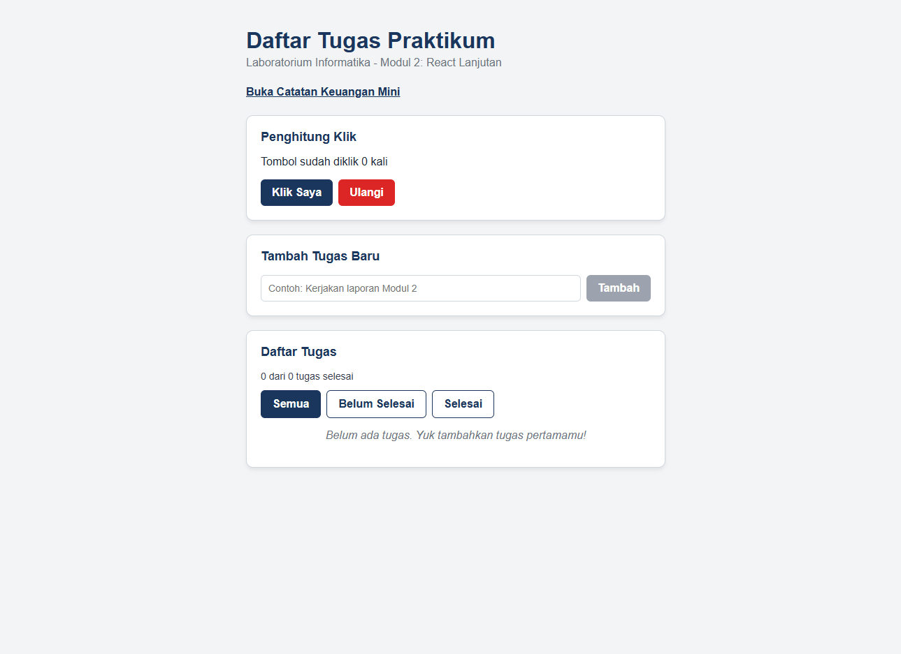
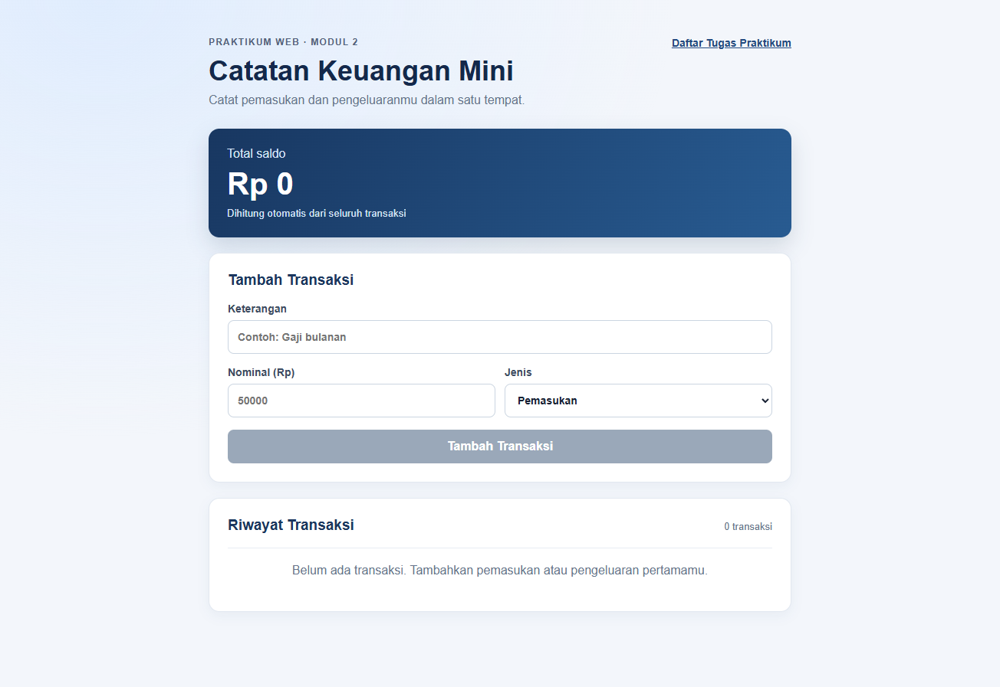
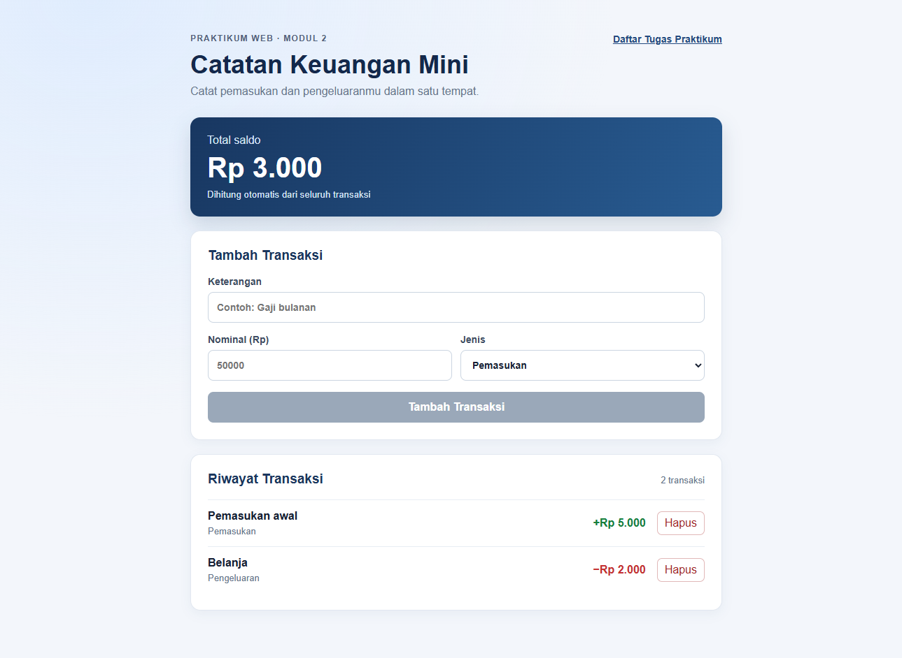
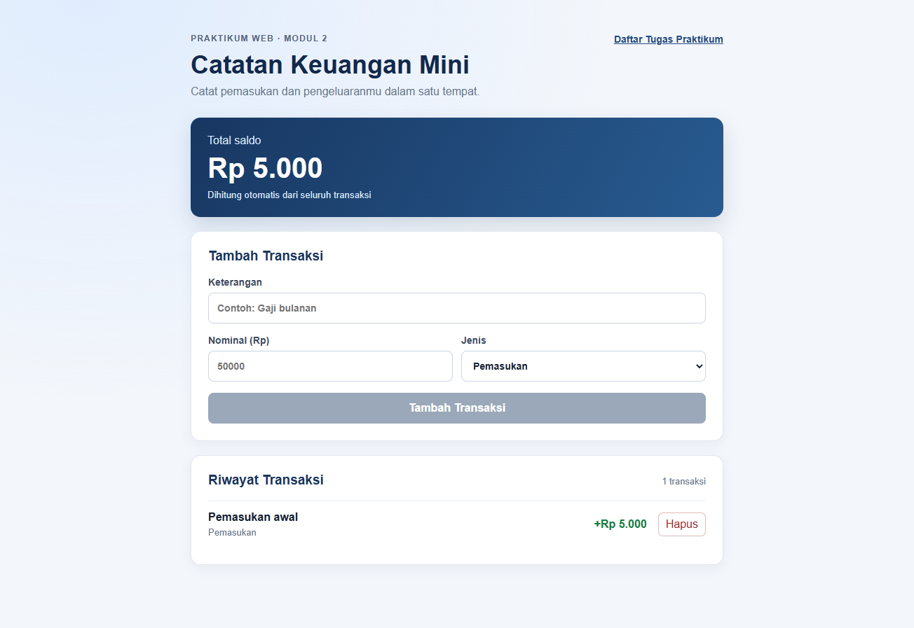

# Laporan Praktikum Web — Modul 2: React Lanjutan

## Identitas Praktikan

| Data | Keterangan |
|---|---|
| Nama | Azriel Mulqie Hakim |
| NPM | 243040016 |
| Kelas | E |
| Mata kuliah | IF21W0508 — Praktikum Web |
| Repository | [Mulqwerty/PW2026_243040016](https://github.com/Mulqwerty/PW2026_243040016) |
| Tanggal pengerjaan | 3 November 2026 |

## Tujuan

Praktikum ini menerapkan event handling, `useState`, pembaruan state secara immutable, formulir terkendali, conditional rendering, komunikasi parent-child melalui function props, dan `useEffect`. Evaluasi dikerjakan pada dua halaman: Daftar Tugas Praktikum dan Catatan Keuangan Mini.

## Implementasi dan Analisis

### 1. Daftar Tugas Praktikum

Daftar tugas disimpan pada state `App`, yaitu komponen induk yang membutuhkan data tersebut untuk menampilkan ringkasan, filter, dan daftar. `FormTugas` hanya mengelola teks input dan melaporkan tugas baru melalui `onTambah`. `ItemTugas` melaporkan perubahan status dan penghapusan melalui callback dari induk.

Penambahan, perubahan, dan penghapusan tugas menggunakan updater state, spread, `.map()`, serta `.filter()`. Cara ini menghasilkan array dan objek baru sehingga React dapat mendeteksi perubahan referensi dan merender tampilan yang sesuai. Nilai ringkasan dan jumlah tugas yang cocok dengan filter dihitung dari state; keduanya tidak disimpan sebagai state tambahan agar tidak terjadi data ganda yang dapat berbeda dari daftar sebenarnya.

Filter Semua, Belum Selesai, dan Selesai menggunakan state terpisah. Filter diterapkan sebelum `.map()`, sementara tombol aktif dibedakan melalui class dan `aria-pressed`. Tombol “Hapus Semua yang Selesai” hanya ditampilkan jika ada tugas selesai dan menghapusnya secara immutable.

`useEffect` menyinkronkan tiga hal di luar proses render: pesan awal pada console, judul tab berdasarkan jumlah tugas belum selesai, dan daftar tugas ke `localStorage`. Lazy initializer membaca data tersimpan hanya saat state awal dibuat. `JSON.stringify` diperlukan karena `localStorage` menyimpan teks, sedangkan data dipulihkan menjadi array dengan `JSON.parse`.

### 2. Catatan Keuangan Mini

Halaman ini merupakan aplikasi terpisah di `/keuangan.html`. Komponen dibagi menjadi `AppKeuangan`, `FormTransaksi`, `DaftarTransaksi`, dan `ItemTransaksi`. Formulir mengendalikan keterangan, nominal, dan jenis transaksi lewat state lokal, lalu mengirim data valid ke induk melalui `onTambah`. Setiap transaksi dapat dihapus melalui callback `onHapus`.

Saldo dihitung langsung dari daftar transaksi: pemasukan ditambahkan dan pengeluaran dikurangkan. Nominal dari input dikonversi dengan `Number` sebelum disimpan, sehingga penjumlahan numerik tidak berubah menjadi penggabungan teks. State tidak menyimpan saldo terpisah karena saldo selalu dapat dihitung dari transaksi. Pemasukan dan pengeluaran ditampilkan dengan warna berbeda. `DaftarTransaksi` menampilkan pesan khusus saat data kosong.

`useEffect` menyimpan daftar transaksi ke `localStorage` setiap kali daftar berubah. Dengan demikian, transaksi dan saldo hasil perhitungannya tetap tersedia setelah halaman dimuat ulang.

## Hasil Pengujian

Pengujian interaksi dilakukan pada halaman Vite lokal. Gambar berikut merupakan bukti tampilan setelah setiap skenario.

### Daftar Tugas Praktikum

| Skenario | Hasil |
|---|---|
| Tambah tugas dengan Enter, input kembali kosong, lalu data tetap ada setelah refresh | Berhasil |
| Judul lebih dari 50 karakter menampilkan validasi dan menonaktifkan tombol Tambah | Berhasil |
| Centang tugas memperbarui teks dan ringkasan jumlah selesai | Berhasil |
| Filter Selesai hanya menampilkan tugas yang selesai; tombol filter aktif ditandai | Berhasil |
| Hapus semua tugas selesai menghapus tugas yang dicentang dan tombol menghilang jika tidak ada lagi | Berhasil |
| Hapus seluruh tugas menampilkan keadaan kosong dan tetap kosong setelah refresh | Berhasil |

### Catatan Keuangan Mini

| Skenario | Hasil |
|---|---|
| Halaman tanpa transaksi menampilkan pesan khusus dan saldo nol | Berhasil |
| Pemasukan Rp5.000 dan pengeluaran Rp2.000 menghasilkan saldo Rp3.000 | Berhasil |
| Nominal pemasukan berwarna hijau dan pengeluaran berwarna merah | Berhasil |
| Transaksi dapat dihapus dan saldo dihitung ulang | Berhasil |
| Data tetap tersimpan setelah refresh; daftar kosong yang disimpan tetap menampilkan keadaan kosong | Berhasil |

## Validasi Teknis

- `npm run build` — berhasil; TypeScript dan kedua halaman produksi berhasil dibangun.
- `npm run lint` — belum dapat berjalan karena konfigurasi dependensi proyek saat ini memakai TypeScript 7.0, sementara `typescript-eslint` yang terpasang belum mendukung TypeScript 7.0.
- Pengujian peramban — seluruh skenario pada tabel di atas berhasil, termasuk persistensi `localStorage`, filter, penghapusan, perhitungan saldo, dan keadaan kosong.

## Kesimpulan

State React digunakan untuk data yang mengubah tampilan, sedangkan nilai yang dapat diturunkan dari data utama dihitung saat render. Pembaruan immutable membantu React mengenali perubahan tanpa memutasi state lama. Formulir terkendali memungkinkan validasi sebelum data dikirim. Function props menjaga aliran data tetap satu arah sambil memungkinkan anak melaporkan aksi ke induk. `useEffect` digunakan hanya untuk menyinkronkan state dengan judul tab dan penyimpanan peramban.

## Pustaka dan Rujukan

1. Meta Platforms, Inc. (2026). [React Documentation](https://react.dev/): Responding to Events, State: A Component's Memory, Updating Arrays in State, Conditional Rendering, Sharing State Between Components, dan Synchronizing with Effects.
2. Mozilla Developer Network. (2026). [Window: localStorage property](https://developer.mozilla.org/docs/Web/API/Window/localStorage) dan [JSON](https://developer.mozilla.org/docs/Web/JavaScript/Reference/Global_Objects/JSON).
3. R. Sandhika Galih Amalga. (2026). *Modul 2 — React Lanjutan: Interaktivitas Komponen dengan Event Handling, State, Formulir Terkendali, Conditional Rendering, Komunikasi Antarkomponen, dan Efek Samping Sederhana*.
